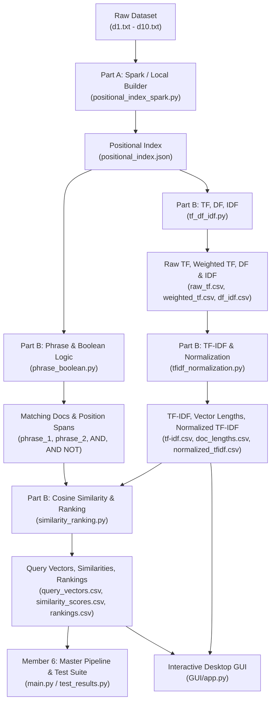

# Education Information Storage and Retrieval (IR) System

> **Course:** IS 313 – Information Storage and Retrieval  
> **Assigned Domain:** Education (`d1.txt` – `d10.txt`)  
> **Term:** Fall 2026  
> **Architecture:** Vector Space Model (VSM) with Positional Inverted Index, Sublinear TF-IDF, $L_2$ Normalization, Boolean Operations, Cosine Similarity Ranking, Tkinter Desktop GUI, and Apache Spark.

---

## Table of Contents
1. [Project Overview](#project-overview)
2. [Team Members and Roles](#team-members-and-roles)
3. [System Architecture and Pipeline](#system-architecture-and-pipeline)
4. [Assigned Dataset](#assigned-dataset)
5. [Mathematical Foundations and Formulations](#mathematical-foundations-and-formulations)
   - [Part A: Positional Inverted Index](#part-a-positional-inverted-index)
   - [Part B: TF, Weighted TF, DF, and IDF](#part-b-tf-weighted-tf-df-and-idf)
   - [Part B: TF-IDF Matrix and Vector Normalization](#part-b-tf-idf-matrix-and-vector-normalization)
   - [Part B: Positional Phrase Matching and Boolean Logic](#part-b-positional-phrase-matching-and-boolean-logic)
   - [Part B: Query Vector, Cosine Similarity, and Ranking](#part-b-query-vector-cosine-similarity-and-ranking)
6. [Benchmark Queries and Ground Truth Results](#benchmark-queries-and-ground-truth-results)
7. [Part C: Theoretical Concept Explanations](#part-c-theoretical-concept-explanations)
8. [Project File Structure](#project-file-structure)
9. [Installation and Dependencies](#installation-and-dependencies)
10. [Execution Guide](#execution-guide)
    - [Running the Complete Pipeline](#1-running-the-complete-pipeline)
    - [Running the Verification Test Suite](#2-running-the-verification-test-suite)
    - [Launching the Desktop GUI](#3-launching-the-desktop-gui)
    - [Running Ad-Hoc / Custom Search Queries](#4-running-ad-hoc--custom-search-queries)
    - [Running Individual Modules](#5-running-individual-modules)
11. [Verification and Testing Summary](#verification-and-testing-summary)

---

## Project Overview

The **Education Information Storage and Retrieval (IR) System** is a complete, modular, classical Vector Space Model search engine developed for an educational document corpus. 

The project demonstrates:
- **Big Data Indexing:** Distributed map-reduce tokenization and positional posting generation using **Apache Spark (PySpark RDDs)** with a robust local fallback engine.
- **Term Weighting:** Raw frequency collection, log-dampened term weighting ($1 + \log_{10}\text{TF}$), and corpus-wide inverse document frequency ($\log_{10}(N / \text{DF})$).
- **Vector Normalization:** Document representation as points in a $|V|$-dimensional Euclidean space with $L_2$ vector normalization ($\| \vec{d} \| = \sqrt{\sum w_{t,d}^2}$) to prevent document length bias.
- **Positional Phrase Matching:** Proximity algorithms that verify exact word sequence adjacency ($p, p+1, p+2, \dots$) and report token span intervals.
- **Boolean Operations:** Exact set intersection (`AND`) and set difference (`AND NOT`) over retrieved phrase candidate sets.
- **Cosine Similarity & Ranking:** Inner-product calculation between normalized query vectors and document vectors with descending score ordering.
- **GUI Application:** Interactive desktop interface built with Python Tkinter for inspecting matrix tables, searching terms, and viewing similarity scores.
- **Quality Assurance:** Automated test suite with **121 unit tests** asserting equality against official course answer keys.

---

## Team Members and Roles

The project is structured according to the six team member responsibilities:

| Member | Project Phase | Primary Script | Core Responsibilities |
|---|---|---|---|
| **Member 1** | **Part A:** Spark Positional Index | `partA/positional_index_spark.py` | Tokenization, distributed PySpark RDD pipeline, building term $\to$ doc $\to$ 1-based token position postings, JSON serialization. |
| **Member 2** | **Part B:** TF, DF & IDF | `partB/tf_df_idf.py` | Calculating Raw Term Frequency ($\text{TF}$), Log-Weighted Term Frequency ($w_{\text{tf}}$), Document Frequency ($\text{DF}$), and Inverse Document Frequency ($\text{IDF}$); CSV exports. |
| **Member 3** | **Part B:** TF-IDF & Normalization | `partB/tfidf_normalization.py` | Constructing the $\text{TF-IDF}$ matrix, computing Document Euclidean lengths ($\| \vec{d} \|$), and length-normalizing weights ($\text{TF-IDF} / \| \vec{d} \|$); CSV exports. |
| **Member 4** | **Part B:** Phrase & Boolean Retrieval | `partB/phrase_boolean.py` | Positional phrase verification ($p, p+1, \dots$), start/end span detection, and Boolean set logic (`AND` intersection, `AND NOT` set difference). |
| **Member 5** | **Part B:** Similarity & Document Ranking | `partB/similarity_ranking.py` | Building normalized query vectors, calculating Cosine Similarity scores, generating descending document rankings; CSV exports. |
| **Member 6** | **Part C:** Integration, Testing & GUI | `main.py`, `test_results.py`, | Master pipeline orchestration, 121-assertion verification test suite, interactive Tkinter desktop GUI, ad-hoc search engine. |

---

## System Architecture and Pipeline

The end-to-end data processing and search pipeline operates in six sequential stages:



---

## Assigned Dataset

The assigned corpus comprises **10 educational text documents** located in `Dataset/`:

| Document ID | Content | Token Count |
|---|---|:---:|
| `d1.txt` | `online learning` | 2 |
| `d2.txt` | `online learning supports student engagement` | 5 |
| `d3.txt` | `student assessment methods improve learning` | 5 |
| `d4.txt` | `classroom teaching supports student engagement and learning outcomes` | 8 |
| `d5.txt` | `online learning student assessment online courses support online learning` | 9 |
| `d6.txt` | `classroom teaching methods support teacher training` | 6 |
| `d7.txt` | `academic performance reflects student progress and learning outcomes` | 8 |
| `d8.txt` | `student assessment student assessment methods improve research and data analysis` | 10 |
| `d9.txt` | `online learning platforms support student learning outcomes digital education systems` | 10 |
| `d10.txt` | `academic performance analysis measures student engagement classroom learning assessment outcomes` | 10 |

**Corpus Statistics:**
- Total Documents ($N$): **10**
- Vocabulary Size ($|V|$): **28 distinct terms**
- Document Length Range: **2 to 10 tokens**

---

## Mathematical Foundations and Formulations

### Part A: Positional Inverted Index
For each distinct term $t \in V$, the positional inverted index maps the term to a posting list of documents, where each document entry contains the 1-based token positions of $t$:

$$\text{Index}(t) = \{ d_i: [p_1, p_2, \dots, p_k] \}$$

Where $p_j$ represents the index position ($1 \le p_j \le |d_i|$) in document $d_i$.

### Part B: TF, Weighted TF, DF, and IDF

1. **Raw Term Frequency ($\text{TF}$):**
   $$\text{TF}(t, d) = \text{number of occurrences of term } t \text{ in document } d$$

2. **Weighted Term Frequency ($w_{\text{tf}}$):**
   Sublinear logarithmic dampening prevents documents with repeated terms from disproportionately dominating retrieval scores:
   $$w_{\text{tf}}(t, d) = \begin{cases} 1 + \log_{10}(\text{TF}(t, d)) & \text{if } \text{TF}(t, d) > 0 \\ 0 & \text{if } \text{TF}(t, d) = 0 \end{cases}$$

3. **Document Frequency ($\text{DF}$):**
   $$\text{DF}(t) = \sum_{d \in D} \mathbb{I}(\text{TF}(t, d) > 0)$$

4. **Inverse Document Frequency ($\text{IDF}$):**
   Calculated with base-10 logarithm and corpus size $N = 10$:
   $$\text{IDF}(t) = \log_{10}\left(\frac{N}{\text{DF}(t)}\right) = \log_{10}(10) - \log_{10}(\text{DF}(t)) = 1 - \log_{10}(\text{DF}(t))$$

### Part B: TF-IDF Matrix and Vector Normalization

1. **TF-IDF Weighting:**
   $$\text{TF-IDF}(t, d) = w_{\text{tf}}(t, d) \times \text{IDF}(t)$$

2. **Document Vector Euclidean Length ($L_2$ Norm):**
   $$\| \vec{d} \| = \sqrt{\sum_{t \in V} \left(\text{TF-IDF}(t, d)\right)^2}$$

3. **Normalized TF-IDF Matrix:**
   $$\hat{d}_{t} = \frac{\text{TF-IDF}(t, d)}{\| \vec{d} \|}$$
   Every document vector has unit length: $\| \vec{\hat{d}} \| = \sqrt{\sum_{t} \hat{d}_t^2} = 1.0$.

### Part B: Positional Phrase Matching and Boolean Logic

1. **Phrase Matching:**
   A phrase $Q = \langle t_1, t_2, \dots, t_m \rangle$ matches document $d$ if and only if:
   $$\exists p \text{ such that } p \in \text{postings}(t_1, d), \; p+1 \in \text{postings}(t_2, d), \; \dots, \; p+m-1 \in \text{postings}(t_m, d)$$
   The span is recorded as $[p, p+m-1]$.

2. **Boolean Operations:**
   - **`AND` (Conjunction):** Intersection of candidate document sets:
     $$\text{Docs}(A \text{ AND } B) = \text{Docs}(A) \cap \text{Docs}(B)$$
   - **`AND NOT` (Negation):** Set difference between candidate document sets:
     $$\text{Docs}(A \text{ AND NOT } B) = \text{Docs}(A) \setminus \text{Docs}(B)$$

### Part B: Query Vector, Cosine Similarity, and Ranking

1. **Query Term Weighting:**
   - For single phrase queries and `AND` queries, all query terms are weighted with $\text{TF}=1$, $w_{\text{tf}}=1.0$.
   - For `AND NOT` queries, only terms from the positive (first) phrase are included in the query vector.
   $$\text{TF-IDF}(t, q) = 1.0 \times \text{IDF}(t)$$
   $$\| \vec{q} \| = \sqrt{\sum_{t \in q} \left(\text{TF-IDF}(t, q)\right)^2}$$
   $$\hat{q}_t = \frac{\text{TF-IDF}(t, q)}{\| \vec{q} \|}$$

2. **Cosine Similarity:**
   Since both document vectors $\vec{\hat{d}}$ and query vector $\vec{\hat{q}}$ are pre-normalized to unit length:
   $$\text{Similarity}(q, d) = \cos(\theta) = \vec{\hat{q}} \cdot \vec{\hat{d}} = \sum_{t \in q} \hat{q}_t \times \hat{d}_{t}$$

3. **Ranking:**
   Documents in the matching set are ranked in descending order of their similarity score:
   $$\text{Rank}(d_i) < \text{Rank}(d_j) \iff \text{Similarity}(q, d_i) \ge \text{Similarity}(q, d_j)$$

---

## Benchmark Queries and Ground Truth Results

All results produced by the pipeline match the official course answer key with zero discrepancy (tolerance $< 10^{-4}$):

### 1. Phrase Query: `"online learning"`
- **Query Vector:** Terms = `[online, learning]`, Length $\| \vec{q} \| = 0.4096$
  - `online`: $\text{IDF} = 0.3979$, $\text{TF-IDF} = 0.3979$, Normalized Weight $= 0.9716$
  - `learning`: $\text{IDF} = 0.0969$, $\text{TF-IDF} = 0.0969$, Normalized Weight $= 0.2366$
- **Matched Spans:**
  - `d1`: starts at `1` (token range: 1–2)
  - `d2`: starts at `1` (token range: 1–2)
  - `d5`: starts at `1, 8` (token ranges: 1–2, 8–9)
  - `d9`: starts at `1` (token range: 1–2)
- **Ranking:**
  1. **`d1`**: $\text{Score} = 1.0000$
  2. **`d5`**: $\text{Score} = 0.4476$
  3. **`d2`**: $\text{Score} = 0.4226$
  4. **`d9`**: $\text{Score} = 0.1939$

### 2. Phrase Query: `"student assessment"`
- **Query Vector:** Terms = `[student, assessment]`, Length $\| \vec{q} \| = 0.4096$
  - `student`: $\text{IDF} = 0.0969$, $\text{TF-IDF} = 0.0969$, Normalized Weight $= 0.2366$
  - `assessment`: $\text{IDF} = 0.3979$, $\text{TF-IDF} = 0.3979$, Normalized Weight $= 0.9716$
- **Matched Spans:**
  - `d3`: starts at `1` (token range: 1–2)
  - `d5`: starts at `3` (token range: 3–4)
  - `d8`: starts at `1, 3` (token ranges: 1–2, 3–4)
- **Ranking:**
  1. **`d3`**: $\text{Score} = 0.4226$
  2. **`d5`**: $\text{Score} = 0.3051$
  3. **`d8`**: $\text{Score} = 0.2731$

### 3. Boolean Query: `"online learning AND student assessment"`
- **Matching Documents:** $\{d_1, d_2, d_5, d_9\} \cap \{d_3, d_5, d_8\} = \{ \mathbf{d_5} \}$
- **Query Vector:** Terms = `[online, learning, student, assessment]`, Length $\| \vec{q} \| = 0.5792$
  - `online`: Normalized Weight $= 0.6870$
  - `learning`: Normalized Weight $= 0.1673$
  - `student`: Normalized Weight $= 0.1673$
  - `assessment`: Normalized Weight $= 0.6870$
- **Ranking:**
  1. **`d5`**: $\text{Score} = 0.5322$

### 4. Boolean Query: `"online learning AND NOT student assessment"`
- **Matching Documents:** $\{d_1, d_2, d_5, d_9\} \setminus \{d_3, d_5, d_8\} = \{ \mathbf{d_1, d_2, d_9} \}$
- **Query Vector:** Terms = `[online, learning]`, Length $\| \vec{q} \| = 0.4096$
- **Ranking:**
  1. **`d1`**: $\text{Score} = 1.0000$
  2. **`d2`**: $\text{Score} = 0.4226$
  3. **`d9`**: $\text{Score} = 0.1939$

---

## Part C: Theoretical Concept Explanations

### 1. How positional information supports phrase queries
A standard (non-positional) inverted index records only the set of documents containing a term. Consequently, if a document contains both "online" and "learning", a non-positional index cannot determine whether the words appear consecutively or paragraphs apart. A **Positional Index** stores the exact 1-based position of every token occurrence. To evaluate a phrase $\langle t_1, t_2, \dots, t_m \rangle$, the retrieval algorithm checks whether document $d$ contains position entries satisfying $pos(t_2) = pos(t_1) + 1, \dots, pos(t_m) = pos(t_1) + m - 1$. This eliminates false positives and enables exact multi-word span matching.

### 2. Relationship between DF and IDF, and why repeated terms affect TF
- **DF vs. IDF:** Document Frequency ($\text{DF}$) and Inverse Document Frequency ($\text{IDF}$) share an inverse logarithmic relationship:
  $$\text{IDF} = \log_{10}(N / \text{DF})$$
  Terms appearing in nearly all documents (e.g. `learning` with $\text{DF}=8$, $\text{IDF}=0.0969$) have negligible discriminative power. Rare terms occurring in few documents (e.g. `digital` with $\text{DF}=1$, $\text{IDF}=1.0000$) provide high discriminative information.
- **Repeated Terms:** A term repeated multiple times in a document increases its raw $\text{TF}$. However, the relevance of a document does not scale linearly with repetition (a document mentioning "assessment" 10 times is not 10 times more relevant than one mentioning it twice). Logarithmic dampening ($w_{\text{tf}} = 1 + \log_{10}\text{TF}$) provides sublinear scaling, ensuring appropriate weighting.

### 3. Purpose of TF-IDF and vector normalization
- **TF-IDF:** Balances local relevance ($w_{\text{tf}}$, how strongly a document discusses a concept) with global specificity ($\text{IDF}$, how unique that concept is across the entire collection).
- **Vector Normalization:** Longer documents naturally contain higher token frequencies and a broader vocabulary, resulting in larger Euclidean lengths ($\| \vec{d} \|$). Without normalization, cosine similarity would inherently favor verbose documents. $L_2$ normalization projects each document vector onto a unit sphere, ensuring fair comparisons based solely on directional angle rather than magnitude.

### 4. How similarity scores are used to rank documents
In the Vector Space Model, queries and documents are mapped into a shared $|V|$-dimensional metric space. The similarity score represents the **cosine of the angle** $\theta$ between the unit query vector and unit document vector:
$$\text{sim}(q, d) = \cos(\theta) = \sum_{t \in q} \hat{q}_t \cdot \hat{d}_t$$
Scores range from $0.0$ (orthogonal vectors, no shared terms) to $1.0$ (collinear vectors, identical term proportions). Retrieved documents are ranked in descending order of similarity, placing the most semantically relevant documents at the top of the search result page.

### 5. Difference between AND and AND NOT using dataset examples
- **`AND` (Intersection):** Requires the simultaneous presence of both phrase conditions.
  - Documents matching `"online learning"`: $\{d_1, d_2, d_5, d_9\}$.
  - Documents matching `"student assessment"`: $\{d_3, d_5, d_8\}$.
  - Conjunction: $\{d_1, d_2, d_5, d_9\} \cap \{d_3, d_5, d_8\} = \{ \mathbf{d_5} \}$.
- **`AND NOT` (Difference / Exclusion):** Selects documents that satisfy the first condition while explicitly excluding any document that satisfies the second condition.
  - Relative complement: $\{d_1, d_2, d_5, d_9\} \setminus \{d_3, d_5, d_8\} = \{ \mathbf{d_1, d_2, d_9} \}$.
  - Notice that $d_5$ is pruned because it also contains "student assessment".

---

## Project File Structure

```text
Education-IR-System/
├── Dataset/                                # Educational text corpus (10 files)
│   ├── d1.txt ... d10.txt
│
├── partA/                                  # Part A: Distributed Indexing
│   └── positional_index_spark.py           # Spark RDD & Local Python positional indexer
│
├── partB/                                  # Part B: Retrieval & Scoring
│   ├── tf_df_idf.py                        # Member 2: Raw TF, Weighted TF, DF & IDF
│   ├── tfidf_normalization.py              # Member 3: TF-IDF matrix & vector normalization
│   ├── phrase_boolean.py                   # Member 4: Phrase search & Boolean logic
│   └── similarity_ranking.py               # Member 5: Cosine similarity & ranking
│
├── GUI/                                    # Interactive Desktop Graphical Interface
│   ├── app.py                              # Main application window & navigation frame
│   ├── home.py                             # Welcome dashboard & corpus overview
│   ├── pages.py                            # Positional Index, TF, DF/IDF, TF-IDF, Norm, Search
│   └── helpers.py                          # Data loaders, styling, custom treeview tables
│
├── output/                                 # Generated matrix artifacts
│   ├── positional_index.json               # Positional inverted index
│   ├── raw_tf.csv                          # Raw term frequencies
│   ├── weighted_tf.csv                     # Sublinear log-weighted TF values
│   ├── df_idf.csv                          # DF and IDF values per vocabulary term
│   ├── tf-idf.csv                          # Unnormalized TF-IDF weights
│   ├── doc_lengths.csv                     # Euclidean L2 vector lengths per document
│   ├── normalized_tfidf.csv                # Unit-normalized TF-IDF weights
│   ├── query_vectors.csv                   # Formatted query vectors for benchmarks
│   ├── similarity_scores.csv               # Cosine similarities
│   └── rankings.csv                        # Ranked document listings
│
├── IR_Project_Documentation_Education_Formal (2).docx # Official course documentation
├── main.py                                 # Member 6: Master pipeline execution script
├── test_results.py                         # Member 6: Automated verification test suite
└── README.md                               # Project documentation (this file)
```

---

## Installation and Dependencies

### Prerequisites
- **Python:** 3.10 or higher
- **Java:** JDK 11 or higher *(Required only if executing PySpark RDD distributed mode; the system automatically falls back to the native Python indexing engine if Java/Spark is not configured)*
- **OS:** Windows / macOS / Linux

### Setup
Clone the repository and verify the environment:
```bash
git clone <repository-url>
cd Education-IR-System
```

Standard library packages (`json`, `math`, `os`, `re`, `csv`, `tkinter`) are included with standard Python installations. If running PySpark:
```bash
pip install pyspark py4j
```

---

## Execution Guide

### 1. Running the Complete Pipeline
Executes Part A, all Part B stages, exports all matrices to `output/`, and validates against the answer key:
```bash
python main.py
```
*Output snippet:*
```text
============================================================================
  RUNNING COMPLETE EDUCATION IR SYSTEM PIPELINE
============================================================================
>> STEP 1 | Part A: Positional Index Construction (Member 1) ... [OK]
>> STEP 2 | Part B: Raw TF, Weighted TF, DF & IDF (Member 2) ... [OK]
>> STEP 3 | Part B: TF-IDF & Document Normalization (Member 3) ... [OK]
>> STEP 4 | Part B: Phrase & Boolean Retrieval (Member 4) ... [OK]
>> STEP 5 | Part B: Similarity Scoring & Ranking (Member 5) ... [OK]
>> STEP 6 | Verification Suite: Comparing with Official Answer Key ... [OK]

==============================
Passed: 121   Failed: 0
==============================
```

### 2. Running the Verification Test Suite
Runs the 121 automated unit tests comparing all terms, postings, TF-IDF cells, document lengths, and similarity scores against the PDF answer key:
```bash
python test_results.py
```
*(Or via CLI: `python main.py --test`)*

### 3. Launching the Desktop GUI
Opens the visual exploration dashboard to inspect matrices, search terms, and test queries:
```bash
python GUI/app.py
```
*(Or via CLI: `python main.py --gui`)*

**GUI Features:**
- **Positional Index:** Interactive search bar for querying vocabulary terms and showing token position postings.
- **TF Matrix:** Toggle between Raw TF and Weighted TF tables.
- **DF & IDF:** View document frequencies and inverse document frequencies.
- **TF-IDF & Normalized TF-IDF:** Comprehensive table displays with document vector lengths.
- **Search & Ranking:** Live query testing for single terms, phrases, `AND`, and `AND NOT` queries with dynamic Cosine Similarity scoring.

### 4. Running Ad-Hoc / Custom Search Queries
Search the corpus directly from the terminal for any query:
```bash
# Single term query
python main.py --query "classroom"

# Multi-word phrase query
python main.py --query "online learning"

# Boolean AND query
python main.py --query "online learning AND student assessment"

# Boolean AND NOT query
python main.py --query "online learning AND NOT student assessment"
```

### 5. Running Individual Modules
Each member's module can be executed independently:
```bash
# Part A: Positional Index
python partA/positional_index_spark.py

# Part B: Member 2 (TF, DF, IDF)
python partB/tf_df_idf.py

# Part B: Member 3 (TF-IDF & Normalization)
python partB/tfidf_normalization.py

# Part B: Member 4 (Phrase & Boolean Queries)
python partB/phrase_boolean.py

# Part B: Member 5 (Cosine Similarity & Ranking)
python partB/similarity_ranking.py
```

---

## Verification and Testing Summary

The project includes an exhaustive automated verification script ([test_results.py](file:///d:/comuter%20science/project%20ir/Education-IR-System/test_results.py)) that validates all calculations against the official IS 313 answer key:

| Test Group | Assertions | Description | Status |
|---|:---:|---|:---:|
| **Part A: Positional Index** | 29 | Terms presence, posting document IDs, and exact token positions | **PASS** |
| **Part B: Phrase & Boolean Queries** | 6 | Phrase matching, start/end spans, `AND`, and `AND NOT` sets | **PASS** |
| **Part B: TF, Weighted TF, DF & IDF** | 59 | Cell counts, raw TF, weighted TF, DF, and IDF across all terms | **PASS** |
| **Part B: TF-IDF & Normalization** | 12 | 10 document vector lengths, 280 TF-IDF cells, 280 normalized cells | **PASS** |
| **Part B: Similarity & Ranking** | 15 | Query vector lengths, cosine similarity values, and ranking orders | **PASS** |
| **Total Test Suite** | **121** | **All tests pass with 0 failures (Tolerance $< 10^{-4}$)** | **100% PASS** |

---

## Conclusion

The **Education Information Storage and Retrieval System** serves as a complete, rigorous, and verifiable implementation of classical vector space search engine principles. All code modules are clean, modular, documented, tested, and ready for academic submission and evaluation.
